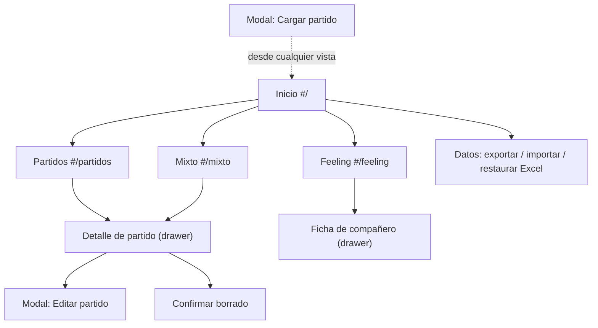
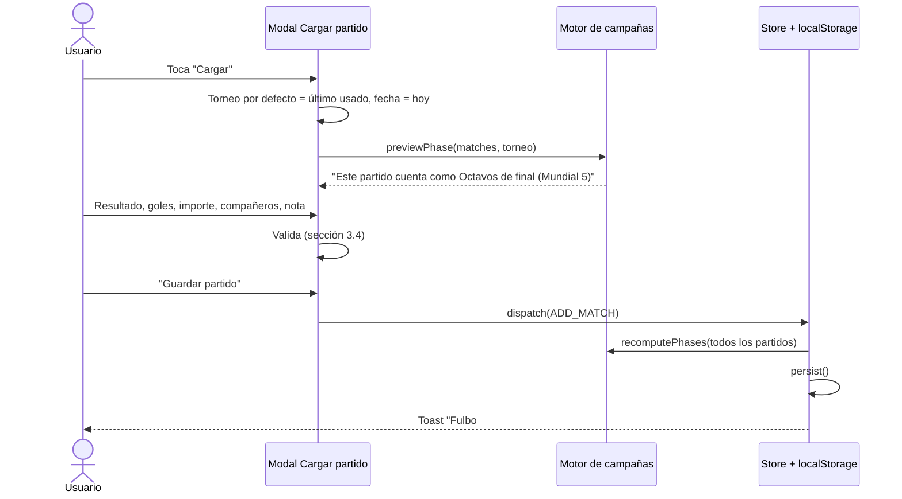

# Blueprint: Tracker de Fútbol 5 y Mundialito 2026

Contrato de desarrollo. Todo número de este documento sale de `FUTBOL 2026.xlsx` (Hoja1) y fue recalculado por script; nada es estimado.

> [!IMPORTANT]
> **Hallazgo central de la planilla.** La columna "fase" no es un fixture fijo de 30 partidos: es una secuencia de **campañas mundialistas**. Cada campaña arranca en Fase de grupos; con 2 victorias pasás a Octavos; en eliminación directa una derrota te elimina y empieza una campaña nueva. Esa regla reproduce las 22 fases de la planilla con **0 diferencias**. La app calcula la fase, no la pide.

---

## 0. Lectura de diseño y datos de origen

**Design Read:** tracker personal de estadísticas para un grupo de amigos, usado sobre todo en el celular justo después del partido, con lenguaje de tablero de estadio nocturno y planilla de vestuario. Dial **ENERGY 2 / RHYTHM 2 / MOTION 1**.

| Dial | Valor | Por qué |
|---|---|---|
| ENERGY | 2 | Es un juego entre amigos con épica (Mundial, Final, Mufa), pero se consulta para leer datos: tiene que tener carácter sin gritar. |
| RHYTHM | 2 | Las vistas comparten estructura (se navegan seguido), con un quiebre fuerte: el módulo "Camino del Mundial" del Inicio. |
| MOTION | 1 | Solo hover, foco y transiciones funcionales (modal, drawer) de 150 ms. Sin contadores animados ni loops. Respeta `prefers-reduced-motion`. |

**Momento de uso principal:** termina el partido, sacás el celular, cargás el fulbo en menos de 30 segundos y ves en qué fase quedó la campaña. Esto ordena todo: mobile primero, botón de carga siempre a un toque, y el estado de la campaña como foco del Inicio.

### 0.1 Números reales verificados

| Métrica | Fútbol 2026 | Mixto | Todo |
|---|---|---|---|
| Partidos | 22 | 3 | 25 |
| Victorias / Empates / Derrotas | 15 / 0 / 7 | 1 / 1 / 1 | 16 / 1 / 8 |
| Win rate | 68,18 % | 33,33 % | 64,00 % |
| Invertido (ARS) | 122.850 | 17.400 | 140.250 |
| Goles personales | 56 (en 21 partidos con dato) | 4 (en 3) | 60 (en 24) |
| Promedio de goles | 2,67 | 1,33 | 2,50 |
| Máximo de goles en un partido | 6 (fulbos 4 y 20) | 3 | 6 |

El "Total $ 140250" de la planilla es la suma de **ambos** torneos. El "Aprox goles 60" también (56 + 4). El "Winrate 68.18" es **solo** Fútbol 2026.

### 0.2 Campañas derivadas (Fútbol 2026)

| Campaña | Fulbos | Resultado |
|---|---|---|
| Mundial 1 | 1 a 6 | Llegó a la Final, la perdió (fulbo 6, nota "💩💩💩🥜🥜") |
| Mundial 2 | 7 a 10 | Eliminado en Octavos |
| Mundial 3 | 11 a 15 | Eliminado en Semifinal |
| Mundial 4 | 16 a 19 | Eliminado en Octavos |
| Mundial 5 | 20 a 22 | **En curso.** Clasificado; el próximo partido es Octavos de final |

Las filas 23 a 30 de la planilla (Octavos, Cuartos, Semi, Final y 4 vacías) son la proyección del camino restante de la campaña 5. La app lo muestra como "camino restante", sin tope de 30 partidos.

### 0.3 Inconsistencias de la planilla y cómo se resuelven

| # | Dato en el Excel | Resolución en la app |
|---|---|---|
| 1 | La tabla Feeling está incompleta: faltan Andre (5 PJ, 3 PG), Mazzi, Alesio, Mateo, NDM y Vali | El Feeling se **calcula** siempre desde los partidos. No se guarda. |
| 2 | Fulbo 9 dice "cioci" | Alias de `ciorci`. Por eso Ciorci da 5 PJ / 4 PG (Excel: 4 / 3). |
| 3 | Fulbo 10 tiene una celda "marki y agustin" | Son 2 jugadores: ese partido tiene 5 compañeros. |
| 4 | Fulbo 13 tiene solo 3 compañeros (4ª celda vacía) | Se guarda con 3. `teamPlayers` acepta de 1 a 5. |
| 5 | Fulbo 12 sin goles | `personalGoals: null` (no registrado). No cuenta para el promedio. |
| 6 | Mixto 2: "derrota(12-9)" | Se interpreta como 9 a favor, 12 en contra. **Confirmar** (ver D3). |
| 7 | Mixto 3: "victoria" sin marcador | `score: null`. |
| 8 | Espacios sobrantes ("conra ", "lauta ") | Normalización: `trim` + minúsculas + tabla de alias. |

---

## 1. Mapa de experiencia y flujo de usuario

### 1.1 Sitemap



| Vista | Trabajo de la pantalla | Decisión que habilita |
|---|---|---|
| **Inicio** | Mostrar en qué fase está la campaña actual y cómo venís | "¿Qué me juego en el próximo partido?" |
| **Partidos** (Match Center) | Historial de Fútbol 2026 agrupado por campaña, con filtros | "¿Cómo me fue con X / en tal fase / tal mes?" |
| **Feeling** | Sinergia con cada compañero | "¿Con quién conviene armar equipo?" |
| **Mixto** | Historial y números del torneo mixto, con marcador | "¿Cómo venimos en el mixto?" |
| **Cargar partido** (modal) | Registrar un fulbo nuevo en menos de 30 s | Guardar |
| **Datos** (sección dentro de Inicio, al pie) | Backup del `localStorage` | Exportar JSON, importar JSON, restaurar datos del Excel |

Rutas por hash (`#/partidos?fase=sf&jugador=fede`) para que funcione abriendo el HTML directo desde el disco y para que "Atrás" del navegador deshaga filtros.

### 1.2 Navegación por dispositivo

| | Mobile (< 1024 px) | Desktop (≥ 1024 px) |
|---|---|---|
| Navegación | Barra inferior fija: Inicio, Partidos, [Cargar], Feeling, Mixto | Barra superior: marca a la izquierda, 4 links al centro, botón "Cargar partido" a la derecha |
| Por qué | El pulgar llega abajo; la carga post-partido queda en el centro | Sin sidebar: son 4 destinos, una columna lateral desperdiciaría ancho que necesita la tabla Feeling |
| Detalle de partido / ficha | Hoja inferior a pantalla completa | Drawer lateral derecho de 420 px |
| Filtros | Botón "Filtrar (n)" que abre hoja inferior | Barra de filtros visible sobre la lista |

### 1.3 Flujo: cargar un partido



- Campos en orden de carga real: **Torneo** (segmentado Fútbol 2026 / Mixto) → **Resultado** (Victoria / Derrota, y Empate solo en Mixto) → **Goles míos** (stepper − / +, vacío permitido) → **Compañeros** (combobox con autocompletado, chips, crear nuevo) → **Importe** (numérico, precargado con el último importe del torneo) → **Fecha** (hoy) → **Marcador** (solo Mixto, opcional) → **Nota** (opcional).
- La fase **no es un campo**: se muestra como línea de lectura calculada por el motor.
- Editar un partido viejo o borrarlo vuelve a calcular las fases y campañas de todos los partidos posteriores.

### 1.4 Flujo: filtrar en Partidos

Filtros combinables (AND), reflejados en la URL:
- **Resultado:** Todos / Victorias / Derrotas
- **Fase:** Grupos / Octavos / Cuartos / Semi / Final (multi)
- **Compañero:** uno o varios (partido incluye a todos los elegidos)
- **Campaña:** Mundial 1..n
- Contador visible: "7 de 22 partidos". Botón "Quitar filtros".
- Tocar un compañero en cualquier lugar (chip de partido, fila de Feeling) abre su ficha; desde la ficha, "Ver partidos juntos" lleva a `#/partidos?jugador=<id>`.

---

## 2. Esquema de datos canónico

### 2.1 Tipos TypeScript

```ts
export type TournamentType = "mundialito" | "mixto";
export type MatchResult = "win" | "loss" | "draw";
export type Phase = "group" | "r16" | "qf" | "sf" | "final";
export type BadgeId = "talisman" | "inseparable" | "mufa" | "invicto";
export type Scope = TournamentType | "all";

export interface Score {
  us: number;
  them: number;
}

export interface Player {
  id: string;            // slug estable: minúsculas, sin espacios
  displayName: string;   // como se muestra en la UI
  aliases: string[];     // variantes escritas en la planilla o al cargar
}

export interface Match {
  id: string;            // "mun-001" | "mix-001" en la semilla; crypto.randomUUID() en nuevos
  tournamentType: TournamentType;
  matchNumber: number;   // correlativo por torneo ("Fulbo n°"), 1..n, sin huecos
  date: string;          // "YYYY-MM-DD"
  cost: number;          // ARS por persona, entero >= 0
  result: MatchResult;   // en "mundialito" solo "win" | "loss"
  personalGoals: number | null; // null = no registrado
  teamPlayers: string[]; // Player.id, de 1 a 5, sin repetidos
  phase: Phase | null;   // "mundialito": lo escribe recomputePhases(); "mixto": siempre null
  notes: string | null;
  score?: Score | null;  // solo "mixto"; si existe debe coincidir con result
}

export interface PlayerStat {
  id: string;            // Player.id
  name: string;          // Player.displayName
  scope: Scope;
  matchesPlayed: number;
  wins: number;
  draws: number;
  losses: number;
  winRate: number;       // wins / matchesPlayed * 100, sin redondear en el store
  badges: BadgeId[];
}

export interface GlobalMetrics {
  scope: Scope;
  totalSpent: number;
  totalMatches: number;
  totalWins: number;
  totalDraws: number;
  totalLosses: number;
  globalWinRate: number;     // totalWins / totalMatches * 100 (empates no suman)
  totalGoals: number;        // suma ignorando null
  matchesWithGoals: number;  // partidos con personalGoals !== null
  avgGoalsPerMatch: number;  // totalGoals / matchesWithGoals
  avgCost: number;           // totalSpent / totalMatches
  maxGoalsInMatch: number;
  currentStreak: { result: MatchResult; count: number } | null;
}

export interface Campaign {
  index: number;             // 1..n
  matchIds: string[];
  status: "active" | "eliminated" | "champion";
  reachedPhase: Phase;       // fase más alta jugada
  eliminatedAt: Phase | null;
  nextPhase: Phase | null;   // solo si status === "active"
  groupRecord: { wins: number; losses: number };
}

export interface PersistedState {
  schemaVersion: 1;
  players: Player[];
  matches: Match[];
  updatedAt: string;         // ISO datetime
}
```

**Reglas del contrato**
- `PlayerStat`, `GlobalMetrics` y `Campaign` son **derivados**: se calculan con funciones puras y nunca se persisten.
- Win rate en UI: 1 decimal con coma (`68,2 %`). En tests se compara con 2 decimales.
- Moneda: `Intl.NumberFormat("es-AR", { style: "currency", currency: "ARS", maximumFractionDigits: 0 })`.
- Fechas: `Intl.DateTimeFormat("es-AR", { weekday: "short", day: "numeric", month: "short" })` → "dom 18 ene". Parsear `date` como fecha local (no `new Date("2026-01-18")`, que corre un día en UTC-3).
- Etiquetas de fase: `group` Fase de grupos, `r16` Octavos de final, `qf` Cuartos de final, `sf` Semifinal, `final` Final. Cortas: Grupos, 8vos, 4tos, Semi, Final.

### 2.2 `seedData`: primeros 5 partidos

```json
[
  {"id": "mun-001", "tournamentType": "mundialito", "matchNumber": 1, "date": "2026-01-18", "cost": 5000, "result": "win", "personalGoals": 4, "teamPlayers": ["agustin", "lea", "conra", "david"], "phase": "group", "notes": null, "score": null},
  {"id": "mun-002", "tournamentType": "mundialito", "matchNumber": 2, "date": "2026-01-25", "cost": 4000, "result": "win", "personalGoals": 4, "teamPlayers": ["conra", "mati", "row", "lauta"], "phase": "group", "notes": null, "score": null},
  {"id": "mun-003", "tournamentType": "mundialito", "matchNumber": 3, "date": "2026-01-31", "cost": 4000, "result": "win", "personalGoals": 2, "teamPlayers": ["ciorci", "jp", "conra", "signo"], "phase": "r16", "notes": null, "score": null},
  {"id": "mun-004", "tournamentType": "mundialito", "matchNumber": 4, "date": "2026-02-07", "cost": 5000, "result": "win", "personalGoals": 6, "teamPlayers": ["franco", "fede", "marki", "diego"], "phase": "qf", "notes": null, "score": null},
  {"id": "mun-005", "tournamentType": "mundialito", "matchNumber": 5, "date": "2026-02-19", "cost": 4200, "result": "win", "personalGoals": 2, "teamPlayers": ["agustin", "aiden", "conra", "ciorci"], "phase": "sf", "notes": null, "score": null}
]
```

Los 25 partidos completos y el registro de jugadores están dentro del Prompt Maestro (sección 5), para que ese bloque sea autocontenido.

### 2.3 Estadísticas esperadas (snapshot para tests)

Fútbol 2026, ordenado por PJ desc, luego WR desc, luego nombre:

| Jugador | PJ | PG | PP | WR | Insignias |
|---|---|---|---|---|---|
| Agustín | 12 | 7 | 5 | 58,33 | inseparable |
| Signo | 10 | 9 | 1 | 90,00 | talisman |
| Conra | 9 | 7 | 2 | 77,78 | |
| Lauta | 6 | 5 | 1 | 83,33 | |
| Ciorci | 5 | 4 | 1 | 80,00 | |
| Andre | 5 | 3 | 2 | 60,00 | |
| Row | 5 | 3 | 2 | 60,00 | |
| Mati | 4 | 3 | 1 | 75,00 | |
| JP | 4 | 2 | 2 | 50,00 | |
| Fede | 4 | 1 | 3 | 25,00 | mufa |
| Aiden | 3 | 3 | 0 | 100,00 | invicto |
| Franco | 3 | 2 | 1 | 66,67 | |
| Mazzi | 3 | 1 | 2 | 33,33 | |
| Oso | 2 | 2 | 0 | 100,00 | invicto |
| Aguado | 2 | 1 | 1 | 50,00 | |
| Alesio | 2 | 1 | 1 | 50,00 | |
| Marki | 2 | 1 | 1 | 50,00 | |
| David, Diego, Lea, Vali | 1 | 1 | 0 | 100,00 | |
| Mateo, NDM, Santi | 1 | 0 | 1 | 0,00 | |

Mixto (sin insignias de ranking: nadie llega a 4 PJ):

| Jugador | PJ | PG | PE | PP | WR |
|---|---|---|---|---|---|
| Agustín | 2 | 1 | 1 | 0 | 50,00 |
| Row | 2 | 1 | 0 | 1 | 50,00 |
| Clara, Conie | 1 | 1 | 0 | 0 | 100,00 |
| Lauta, Negra, Mica ❤ | 1 | 0 | 1 | 0 | 0,00 |
| Andre, Lara, Cande | 1 | 0 | 0 | 1 | 0,00 |

---

## 3. Arquitectura de componentes y estado

### 3.1 Árbol de componentes

```text
<App>
├─ <StoreProvider>                      contexto + useReducer + persistencia
│  ├─ <TopBar>                          desktop: marca, <NavLinks>, <AddMatchButton>
│  ├─ <Router>                          hash router propio (sin dependencia)
│  │  ├─ <HomeView>
│  │  │  ├─ <CampaignPath>              FOCO: camino del Mundial actual
│  │  │  ├─ <ScopeSwitch>               Fútbol 2026 | Mixto | Todo
│  │  │  ├─ <WinRateGauge>
│  │  │  ├─ <KpiStrip>                  partidos, goles, invertido, racha
│  │  │  ├─ <FormGuide>                 últimos 5: V D V V V
│  │  │  ├─ <CampaignHistory>           Mundial 1..n en una línea cada uno
│  │  │  ├─ <FeelingHighlights>         Talismán, Inseparable, Mufa, Invictos
│  │  │  └─ <DataPanel>                 exportar, importar, restaurar Excel
│  │  ├─ <MatchesView>
│  │  │  ├─ <FilterBar> / <FilterSheet>
│  │  │  ├─ <ResultCount>
│  │  │  └─ <CampaignGroup> × n         encabezado "Mundial 5, en curso"
│  │  │     └─ <MatchCard> × n
│  │  │        ├─ <ResultMark>          V / D / E
│  │  │        ├─ <PhaseTrack size="mini">
│  │  │        └─ <PlayerChip> × 1..5
│  │  ├─ <FeelingView>
│  │  │  ├─ <ScopeSwitch>
│  │  │  ├─ <BadgeLegend>
│  │  │  └─ <SynergyTable>              desktop tabla / mobile filas apiladas
│  │  │     └─ <SynergyRow> × n
│  │  └─ <MixtoView>
│  │     ├─ <KpiStrip scope="mixto">
│  │     └─ <MatchCard variant="score"> × n
│  ├─ <MatchDrawer>                     detalle, editar, borrar
│  ├─ <PlayerDrawer>                    ficha + partidos juntos
│  ├─ <AddMatchModal>                   también modo edición
│  │  ├─ <SegmentedControl>
│  │  ├─ <GoalStepper>
│  │  ├─ <PlayerCombobox>
│  │  └─ <PhasePreview>
│  ├─ <ConfirmDialog>
│  ├─ <Toast>
│  └─ <BottomNav>                       mobile
```

Componentes compartidos con su porqué:
- `<PhaseTrack>`: motivo de identidad. Cinco segmentos Grupos · 8vos · 4tos · Semi · Final. Aparece grande en el Inicio, mini en cada `MatchCard` (segmento del partido encendido) y como selector en filtros. Es lo único que hace que la app sea de **este** torneo y no un dashboard genérico.
- `<PlayerChip>`: iniciales en un círculo de 28 px con color derivado del id (hash a una de 6 tonalidades neutras-verdosas) y nombre. **Sin fotos ni avatares generados.**

### 3.2 Estado

```ts
interface UiState {
  scope: Scope;                          // persistido aparte, default "mundialito"
  filters: {                             // vive en la URL, no en localStorage
    result: "all" | "win" | "loss";
    phases: Phase[];
    players: string[];
    campaign: number | null;
  };
  openMatchId: string | null;
  openPlayerId: string | null;
  modal: { kind: "add" } | { kind: "edit"; matchId: string } | null;
}

type Action =
  | { type: "ADD_MATCH"; match: Omit<Match, "id" | "matchNumber" | "phase"> }
  | { type: "UPDATE_MATCH"; match: Match }
  | { type: "DELETE_MATCH"; id: string }
  | { type: "ADD_PLAYER"; player: Player }
  | { type: "IMPORT_STATE"; state: PersistedState }
  | { type: "RESET_TO_SEED" };
```

- Todo reducer que toca `matches` termina en `renumber()` (matchNumber correlativo por torneo, ordenado por fecha y luego por número previo) y `recomputePhases()`.
- Selectores memoizados (`useMemo` sobre `matches`): `selectMetrics(scope)`, `selectPlayerStats(scope)`, `selectCampaigns()`, `selectFilteredMatches(filters)`.
- **Persistencia:** clave `fulbo-tracker:v1` guarda `PersistedState`; clave `fulbo-tracker:ui:v1` guarda `{ scope, lastTournament }`. Se escribe en cada acción, envuelto en `try/catch` (cuota llena o modo privado → toast de error, el estado en memoria sigue).
- **Carga:** si no existe la clave, se usa la semilla. Si existe pero el JSON es inválido o `schemaVersion` desconocido, se muestra la pantalla de error (3.5) y **no** se pisa el contenido guardado.

### 3.3 Algoritmos

**A. Motor de campañas y fases**

```text
CONST KNOCKOUT = [r16, qf, sf, final]

function recomputePhases(matches):
    ms = matches donde tournamentType = "mundialito", ordenados por matchNumber
    campaigns = []; camp = nuevaCampaña(1)
    phase = group; gW = 0; gL = 0
    for m in ms:
        m.phase = phase
        camp.matchIds.push(m.id); camp.reachedPhase = max(camp.reachedPhase, phase)
        if phase == group:
            if m.result == win: gW += 1 else: gL += 1
            if gW == 2: phase = r16
            else if gL == 2: cerrar(camp, eliminated, group); camp = nueva; phase = group; gW = gL = 0
        else:
            if m.result == win and phase != final: phase = siguiente(phase)
            else if m.result == win and phase == final: cerrar(camp, champion, null); camp = nueva; phase = group; gW = gL = 0
            else: cerrar(camp, eliminated, phase); camp = nueva; phase = group; gW = gL = 0
    if camp.matchIds no vacío: camp.status = active; camp.nextPhase = phase
    else: la campaña nueva vacía se representa como "próximo: Fase de grupos"
    return { matches con phase, campaigns }

function previewPhase(matches): devuelve la "phase" que recibiría el próximo partido
```

Verificación obligatoria: aplicado a la semilla, cada `phase` calculada es igual a la de la planilla (22/22) y `nextPhase` de la campaña 5 es `r16`.

> [!NOTE]
> Dos casos nunca ocurrieron en la planilla y se asumen: (a) 2 derrotas en grupos eliminan; (b) ganar la Final cierra la campaña como campeón y la siguiente arranca en grupos. Ver D4.

**B. Feeling: win rate por compañero**

```text
function computePlayerStats(matches, players, scope):
    ms = scope == "all" ? matches : matches filtrados por tournamentType == scope
    acc = mapa vacío playerId -> {pj, w, d, l}
    for m in ms:
        for pid in unique(m.teamPlayers):
            a = acc[pid] ?? {0,0,0,0}
            a.pj += 1
            si m.result == win: a.w += 1; draw: a.d += 1; loss: a.l += 1
    stats = para cada (pid, a): { id, name: players[pid].displayName, scope,
             matchesPlayed: a.pj, wins: a.w, draws: a.d, losses: a.l,
             winRate: a.w / a.pj * 100, badges: [] }
    assignBadges(stats)
    ordenar por matchesPlayed desc, winRate desc, name asc
```

**C. Insignias**

```text
CONST MIN_PJ_RANKING = 4    // Talismán y Mufa: evita que 1 de 1 gane el ranking
CONST MIN_PJ_INVICTO = 2

function assignBadges(stats):
    elegibles = stats con matchesPlayed >= MIN_PJ_RANKING
    if elegibles no vacío:
        talisman = max(elegibles) por winRate, desempate matchesPlayed desc, name asc
        mufa     = min(elegibles) por winRate, desempate matchesPlayed desc, name asc
        talisman.badges.push("talisman")
        if mufa != talisman: mufa.badges.push("mufa")
    if stats no vacío:
        maxPJ = max(matchesPlayed)
        si maxPJ >= 2: cada s con matchesPlayed == maxPJ -> push("inseparable")
    cada s con winRate == 100 y matchesPlayed >= MIN_PJ_INVICTO -> push("invicto")
```

Resultado esperado en Fútbol 2026: Talismán **Signo**, Inseparable **Agustín**, Mufa **Fede**, Invicto **Aiden** y **Oso**. En Mixto: solo Inseparable compartido por Agustín y Row (2 PJ); Talismán y Mufa muestran estado vacío.

**D. Métricas globales**

```text
function computeMetrics(matches, scope):
    ms = filtrar por scope; si vacío -> métricas en 0 y currentStreak null
    totalGoals = suma de personalGoals no null
    matchesWithGoals = cantidad con personalGoals no null
    avgGoalsPerMatch = matchesWithGoals > 0 ? totalGoals / matchesWithGoals : 0
    currentStreak: recorrer ms ordenados por fecha desc mientras result == ms[0].result
```

Esperado (Fútbol 2026): racha actual 2 victorias (fulbos 21 y 22).

### 3.4 Validación del formulario

| Campo | Regla | Mensaje |
|---|---|---|
| Fecha | requerida, formato válido, no posterior a hoy + 1 día | "Poné la fecha del partido." |
| Resultado | requerido; Empate solo en Mixto | "Elegí cómo salió." |
| Importe | entero de 0 a 100.000 | "El importe va en pesos, sin centavos." |
| Goles | vacío o entero de 0 a 30 | "Los goles van de 0 a 30, o dejalo vacío." |
| Compañeros | de 1 a 5, sin repetir | "Sumá al menos un compañero." |
| Marcador (Mixto) | ambos o ninguno; coherente con resultado | "El marcador no coincide con el resultado." |
| Nota | máx. 140 caracteres | contador visible |

Crear compañero nuevo: el nombre escrito se normaliza (`trim`, minúsculas, sin tildes) y se compara contra `id` y `aliases`; si coincide, se usa el existente.

### 3.5 Estados obligatorios

| Situación | Qué se ve | Acción |
|---|---|---|
| Sin partidos en el torneo (primer uso de Mixto, o tras borrar todo) | "Todavía no cargaste partidos de Mixto." | Botón "Cargar el primero" |
| Filtros sin resultado | "Ningún partido con Fede en Semifinal." (texto armado con los filtros activos) | "Quitar filtros" |
| Feeling sin elegibles para ranking | "Talismán y Mufa aparecen cuando alguien juega 4 partidos con vos. Hoy el máximo es 2." | ninguna |
| Importando un JSON | "Leyendo copia de seguridad…" con indicador en el botón | se bloquea el doble clic |
| `localStorage` corrupto o versión desconocida | "No pudimos leer tus datos guardados." | "Descargar lo guardado tal cual", "Restaurar datos del Excel" (con confirmación) |
| Escritura falla (cuota/privado) | Toast: "No se pudo guardar en este navegador. Exportá una copia para no perder el partido." | "Exportar ahora" |
| Import inválido | "El archivo no es una copia de Fulbo Tracker." | cerrar |

---

## 4. Wireframes y UI spec

### 4.1 Inicio, desktop

```text
+--------------------------------------------------------------------------------+
| FULBO 2026        Inicio   Partidos   Feeling   Mixto        [ Cargar partido ] |
+--------------------------------------------------------------------------------+
|                                                                                |
|  MUNDIAL 5 · EN CURSO                                                          |
|  Próximo partido: Octavos de final                         (titular, 40px)     |
|                                                                                |
|  [ GRUPOS  D V V ]==[ 8VOS ]--[ 4TOS ]--[ SEMI ]--[ FINAL ]                     |
|   ^ completo, verde   ^ siguiente (borde verde)   resto: gris                   |
|  Ganá 4 seguidos para salir campeón.                                           |
|                                                                                |
+-----------------------------------+--------------------------------------------+
|  [Fútbol 2026] [Mixto] [Todo]     |                                            |
|                                   |   Partidos 22    Goles 56     Invertido     |
|        .-""""-.                   |   15 V · 7 D     2,67 x pdo   ARS 122.850   |
|      /   68,2%  \                 |                  en 21 con    ARS 5.584     |
|     |  ganados   |  15 de 22      |                  dato         x pdo         |
|                                   |   Racha: 2 V                               |
|                                   |   Últimos 5:  D  V  D  V  V                 |
+-----------------------------------+--------------------------------------------+
|  CAMPAÑAS                         |  FEELING                                   |
|  M5  20-22  en curso, a 8vos      |  Talismán     Signo    90,0 %  10 PJ        |
|  M4  16-19  afuera en 8vos        |  Inseparable  Agustín  12 PJ   58,3 %       |
|  M3  11-15  afuera en Semi        |  Mufa         Fede     25,0 %  4 PJ         |
|  M2   7-10  afuera en 8vos        |  Invictos     Aiden 3/3 · Oso 2/2           |
|  M1   1-6   subcampeón            |  Ver tabla completa                        |
+-----------------------------------+--------------------------------------------+
|  Tus datos viven en este navegador.  Exportar copia · Importar · Restaurar Excel |
+--------------------------------------------------------------------------------+
```

Jerarquía: el bloque de campaña es el único foco (titular grande, único uso de verde en superficie). El gauge es el segundo nivel. Los KPI no son 4 cards iguales: es una franja de texto con números grandes y su contexto debajo, porque los números solo significan algo con su denominador ("en 21 con dato").

**WinRateGauge:** arco SVG de 180°, trazo de 12 px. Pista `--line`, relleno `--win` proporcional al WR. Número centrado en Barlow Condensed 44 px. `role="img"` con `aria-label="Win rate 68,2 por ciento, 15 de 22"`. Sin animación de llenado.

### 4.2 Inicio, mobile (360 px)

```text
+------------------------------+
| FULBO 2026                   |
|                              |
| MUNDIAL 5 · EN CURSO         |
| Próximo: Octavos de final    |
| [GRP]=[8vos]-[4tos]-[S]-[F]  |
| Ganá 4 seguidos para el      |
| título.                      |
|------------------------------|
| [Fútbol 2026][Mixto][Todo]   |
|   ( 68,2% )   15 de 22       |
|  22 pdos · 56 goles          |
|  ARS 122.850 invertidos      |
|  Últimos 5: D V D V V        |
|------------------------------|
| Talismán  Signo   90,0 %     |
| Mufa      Fede    25,0 %     |
|------------------------------|
| Inicio Partidos [+] Feeling Mixto |
+------------------------------+
```

### 4.3 Match Card

```text
Desktop / mobile (misma estructura, se apila en < 400 px)
+---+---------------------------------------------------------------+
| V |  Fulbo #22 · vie 31 oct                   ARS 5.500           |
|   |  [grp]=[8]-[4]-[S]-[F]   Fase de grupos · Mundial 5           |
|   |  (LA) Lauta  (AG) Agustín  (SI) Signo  (CO) Conra             |
|   |  1 gol                                                        |
+---+---------------------------------------------------------------+

+---+---------------------------------------------------------------+
| D |  Fulbo #6 · jue 26 feb                    ARS 5.500           |
|   |  [g]=[8]=[4]=[S]=[FINAL]   Final · Mundial 1                  |
|   |  (AG) Aguado  (JP) JP  (RO) Row  (CI) Ciorci                  |
|   |  2 goles   "💩💩💩🥜🥜"                                         |
+---+---------------------------------------------------------------+

Mixto (variant="score")
+---+---------------------------------------------------------------+
| E |  Mixto #1 · mié 28 ene        11 - 11          ARS 5.200      |
|   |  (LA) Lauta  (AG) Agustín  (NE) Negra  (MI) Mica ❤            |
|   |  3 goles                                                      |
+---+---------------------------------------------------------------+
```

- Columna izquierda de 40 px con la letra del resultado (V / D / E) sobre fondo de estado. Es la franja de color, y está permitida porque **marca un estado real** (resultado), no decora. La letra garantiza que el resultado se lea sin depender del color.
- Goles `null` → "Goles sin registrar" en `--text-muted`.
- Nota entre comillas, tal cual la escribió el usuario (emojis incluidos: son contenido del usuario, no decoración de la UI).
- Toda la card es un `<button>` que abre el drawer de detalle; los chips de jugador son botones propios (stopPropagation) que abren su ficha.

### 4.4 Tabla Feeling

```text
Desktop
+--------------------------------------------------------------------------------+
| Feeling con tus compañeros          [Fútbol 2026] [Mixto] [Todo]               |
| Talismán y Mufa se calculan entre quienes jugaron 4 o más partidos con vos.     |
+--------------------------------------------------------------------------------+
| Compañero ▾      PJ ▾   PG   PP   Win rate ▾                     Insignias      |
|--------------------------------------------------------------------------------|
| (AG) Agustín     12     7    5    58,3 %  [=========-------]     Inseparable    |
| (SI) Signo       10     9    1    90,0 %  [==============--]     Talismán       |
| (CO) Conra        9     7    2    77,8 %  [============----]                    |
| ...                                                                            |
| (FE) Fede         4     1    3    25,0 %  [====------------]     Mufa           |
| (AI) Aiden        3     3    0   100,0 %  [================]     Invicto        |
| ...                                                                            |
| (SA) Santi        1     0    1     0,0 %  [----------------]                    |
+--------------------------------------------------------------------------------+

Mobile: filas apiladas, sin scroll horizontal
+------------------------------+
| (SI) Signo        Talismán   |
| 90,0 %  [===========--]      |
| 10 PJ · 9 PG · 1 PP          |
+------------------------------+
```

- Ordenable por Compañero, PJ y Win rate (`<button>` en el `<th>`, `aria-sort`). Orden inicial: PJ desc.
- Barra de WR: pista `--line`, relleno `--win` si WR ≥ 50, `--loss` si < 50. El número siempre está al lado; la barra no es la única fuente del dato.
- Con PJ = 1 la fila va en `--text-muted` con nota "1 partido" para que nadie lea 100 % como dato fuerte.
- Insignias: texto en mayúscula normal (sin tracking extremo), 12 px, borde de 1 px, radio 4 px, color dorado para Talismán e Invicto, rojo para Mufa, neutro para Inseparable. Sin brillo, sin punto.

### 4.5 Paleta

Dark por decisión del dueño del producto (uso nocturno post-partido, identidad de estadio de noche). Tres colores de núcleo con significado fijo, más neutros:

| Token | Hex | Uso | Contraste verificado (`contrast-check.py`) |
|---|---|---|---|
| `--bg` | `#0B0F0C` | Fondo (negro verdoso, césped de noche) | |
| `--surface` | `#131A15` | Bloques y cards | |
| `--surface-2` | `#1B241E` | Hover, inputs, drawer | |
| `--line` | `#2A352D` | Divisores estructurales no interactivos | |
| `--line-strong` | `#67776C` | Bordes de controles interactivos, pistas de barras y chips | 4,07:1 sobre `--bg` · 3,73:1 sobre `--surface` · 3,36:1 sobre `--surface-2` (PASS 3:1 WCAG 1.4.11) |
| `--text` | `#E9F0EA` | Texto principal | 16,65:1 (`--bg`) · 15,27:1 (`--surface`) · 13,75:1 (`--surface-2`) |
| `--text-muted` | `#9AA89F` | Texto secundario | 7,79:1 (`--bg`) · 7,14:1 (`--surface`) · 6,43:1 (`--surface-2`) |
| `--win` | `#22C55E` | Victoria, CTA principal, fase actual | 8,47:1 (`--bg`) · 7,77:1 (`--surface`) · 7,00:1 (`--surface-2`) |
| `--on-win` | `#052E16` | Texto sobre `--win` | 6,54:1 sobre `--win` |
| `--gold` | `#EAB308` | Final, Talismán, Invicto, campeón | 10,07:1 (`--bg`) · 9,23:1 (`--surface`) · 8,32:1 (`--surface-2`) |
| `--loss` | `#F87171` | Derrota, Mufa, errores | 6,96:1 (`--bg`) · 6,38:1 (`--surface`) · 5,76:1 (`--surface-2`) |
| `--on-loss` | `#1F0707` | Texto sobre `--loss` | 6,95:1 sobre `--loss` |

Todos los pares fueron verificados con `contrast-check.py` (WCAG AA 4.5:1 para texto normal y 3.0:1 para bordes de controles y pistas de gráfico).

Reglas de uso:
- **Verde = acento y victoria.** Superficie verde solo en el CTA "Cargar partido" y en el segmento siguiente del `PhaseTrack` (borde). En cards, el verde vive únicamente en la columna de resultado.
- **Dorado** solo donde hay algo que se gana: Final, Talismán, Invicto.
- **Rojo** solo para derrota, Mufa y errores.
- Empate usa `--text-muted`, no un cuarto color.
- Sin gradientes, sin glassmorphism, sin glow. Sombra solo en modal y drawer (elevación real sobre el contenido).

### 4.6 Tipografía, forma y espacio

| Decisión | Valor | Por qué |
|---|---|---|
| Titulares y números | **Barlow Condensed** 600/700, `font-variant-numeric: tabular-nums` | Condensada como los números de camiseta y los tableros; entran cifras grandes en anchos chicos de mobile |
| Texto | **Barlow** 400/500, 15 px base mobile, 16 px desktop | Misma familia que los titulares: coherencia sin un segundo carácter |
| Fuentes | Autohospedadas con `@fontsource` | Funciona sin red y dentro del HTML único |
| Radios | 4 px chips e insignias, 8 px cards e inputs, 12 px modal | Tres niveles para que el radio diga qué es cada cosa |
| Espaciado | Escala 4 / 8 / 12 / 16 / 24 / 40 / 64 | 40-64 separa bloques del Inicio; 12-16 dentro de cards |
| Foco | `outline: 2px solid var(--win); outline-offset: 2px` | Visible sobre todas las superficies oscuras |
| Tap targets | mínimo 44 × 44 px | R-03 |
| Breakpoints | 360 (base), 640, 1024, 1280 (ancho máximo de contenido 1200 px) | |

### 4.7 Íconos

Se usan solo donde un texto solo sería más lento de leer, con este set cerrado:

| Lugar | Ícono | Relevancia |
|---|---|---|
| Botón cargar (mobile) | `Plus` | Acción de agregar, universal |
| Nav Inicio / Partidos / Feeling / Mixto | `House` / `ListOrdered` / `Users` / `Shuffle` | Siempre con etiqueta de texto debajo |
| Insignia Talismán / Campeón | `Trophy` | Algo que se gana |
| Filtros | `SlidersHorizontal` | Abrir filtros |
| Editar / Borrar | `Pencil` / `Trash2` | Acciones del drawer |
| Cerrar | `X` | Modal y drawer |

Ver decisión pendiente **D1** sobre la librería.

---

## 5. Prompt Maestro de implementación

Copiar desde la línea siguiente hasta el final del bloque.

````text
Sos un desarrollador frontend senior. Construí "Fulbo Tracker 2026", una app web personal para registrar partidos de fútbol 5. Seguí esta especificación al pie de la letra. No inventes datos, secciones, testimonios, estadísticas ni funciones que no estén acá.

## STACK (obligatorio)
- Vite 6 + React 19 + TypeScript (strict) + Tailwind CSS v4.
- lucide-react solo para los íconos listados en "ÍCONOS".
- @fontsource/barlow (400, 500) y @fontsource/barlow-condensed (600, 700).
- vite-plugin-singlefile: `npm run build` debe producir UN SOLO `dist/index.html` que funcione con doble clic (file://).
- Vitest para tests de lógica.
- Sin librerías de gráficos, de estado ni de routing: SVG propio, useReducer + Context, hash router propio.
- Persistencia en localStorage. Sin backend.

## ESTRUCTURA
src/
  domain/types.ts         tipos
  domain/seed.ts          SEED_PLAYERS y SEED_MATCHES (copiar literal de abajo)
  domain/campaigns.ts     recomputePhases, previewPhase
  domain/stats.ts         computePlayerStats, assignBadges, computeMetrics
  domain/normalize.ts     normalizePlayerName, findOrCreatePlayer
  domain/format.ts        moneda, fecha local, porcentaje
  store/                  reducer, provider, persistencia
  components/             un archivo por componente
  views/                  HomeView, MatchesView, FeelingView, MixtoView
  tests/                  *.test.ts

## TIPOS
type TournamentType = "mundialito" | "mixto";
type MatchResult = "win" | "loss" | "draw";
type Phase = "group" | "r16" | "qf" | "sf" | "final";
type BadgeId = "talisman" | "inseparable" | "mufa" | "invicto";
type Scope = TournamentType | "all";
interface Score { us: number; them: number }
interface Player { id: string; displayName: string; aliases: string[] }
interface Match {
  id: string; tournamentType: TournamentType; matchNumber: number;
  date: string /* YYYY-MM-DD */; cost: number /* ARS por persona */;
  result: MatchResult /* mundialito: solo win|loss */;
  personalGoals: number | null /* null = sin registrar */;
  teamPlayers: string[] /* Player.id, 1 a 5, sin repetidos */;
  phase: Phase | null /* mundialito: calculado; mixto: null */;
  notes: string | null; score?: Score | null /* solo mixto */;
}
interface PlayerStat { id: string; name: string; scope: Scope; matchesPlayed: number; wins: number; draws: number; losses: number; winRate: number; badges: BadgeId[] }
interface GlobalMetrics { scope: Scope; totalSpent: number; totalMatches: number; totalWins: number; totalDraws: number; totalLosses: number; globalWinRate: number; totalGoals: number; matchesWithGoals: number; avgGoalsPerMatch: number; avgCost: number; maxGoalsInMatch: number; currentStreak: { result: MatchResult; count: number } | null }
interface Campaign { index: number; matchIds: string[]; status: "active" | "eliminated" | "champion"; reachedPhase: Phase; eliminatedAt: Phase | null; nextPhase: Phase | null; groupRecord: { wins: number; losses: number } }
interface PersistedState { schemaVersion: 1; players: Player[]; matches: Match[]; updatedAt: string }

PlayerStat, GlobalMetrics y Campaign son derivados: funciones puras, nunca persistidos.

## DATOS SEMILLA (copiar literal)
SEED_PLAYERS =
[{"id":"aguado","displayName":"Aguado","aliases":[]},{"id":"agustin","displayName":"Agustín","aliases":["agustín"]},{"id":"aiden","displayName":"Aiden","aliases":[]},{"id":"alesio","displayName":"Alesio","aliases":[]},{"id":"andre","displayName":"Andre","aliases":[]},{"id":"cande","displayName":"Cande","aliases":[]},{"id":"ciorci","displayName":"Ciorci","aliases":["cioci"]},{"id":"clara","displayName":"Clara","aliases":[]},{"id":"conie","displayName":"Conie","aliases":[]},{"id":"conra","displayName":"Conra","aliases":[]},{"id":"david","displayName":"David","aliases":[]},{"id":"diego","displayName":"Diego","aliases":[]},{"id":"fede","displayName":"Fede","aliases":[]},{"id":"franco","displayName":"Franco","aliases":[]},{"id":"jp","displayName":"JP","aliases":[]},{"id":"lara","displayName":"Lara","aliases":[]},{"id":"lauta","displayName":"Lauta","aliases":[]},{"id":"lea","displayName":"Lea","aliases":[]},{"id":"marki","displayName":"Marki","aliases":[]},{"id":"mateo","displayName":"Mateo","aliases":[]},{"id":"mati","displayName":"Mati","aliases":[]},{"id":"mazzi","displayName":"Mazzi","aliases":[]},{"id":"mica","displayName":"Mica ❤","aliases":["mica❤"]},{"id":"ndm","displayName":"NDM","aliases":[]},{"id":"negra","displayName":"Negra","aliases":[]},{"id":"oso","displayName":"Oso","aliases":[]},{"id":"row","displayName":"Row","aliases":[]},{"id":"santi","displayName":"Santi","aliases":[]},{"id":"signo","displayName":"Signo","aliases":[]},{"id":"vali","displayName":"Vali","aliases":[]}]

SEED_MATCHES =
[{"id":"mun-001","tournamentType":"mundialito","matchNumber":1,"date":"2026-01-18","cost":5000,"result":"win","personalGoals":4,"teamPlayers":["agustin","lea","conra","david"],"phase":"group","notes":null,"score":null},
{"id":"mun-002","tournamentType":"mundialito","matchNumber":2,"date":"2026-01-25","cost":4000,"result":"win","personalGoals":4,"teamPlayers":["conra","mati","row","lauta"],"phase":"group","notes":null,"score":null},
{"id":"mun-003","tournamentType":"mundialito","matchNumber":3,"date":"2026-01-31","cost":4000,"result":"win","personalGoals":2,"teamPlayers":["ciorci","jp","conra","signo"],"phase":"r16","notes":null,"score":null},
{"id":"mun-004","tournamentType":"mundialito","matchNumber":4,"date":"2026-02-07","cost":5000,"result":"win","personalGoals":6,"teamPlayers":["franco","fede","marki","diego"],"phase":"qf","notes":null,"score":null},
{"id":"mun-005","tournamentType":"mundialito","matchNumber":5,"date":"2026-02-19","cost":4200,"result":"win","personalGoals":2,"teamPlayers":["agustin","aiden","conra","ciorci"],"phase":"sf","notes":null,"score":null},
{"id":"mun-006","tournamentType":"mundialito","matchNumber":6,"date":"2026-02-26","cost":5500,"result":"loss","personalGoals":2,"teamPlayers":["aguado","jp","row","ciorci"],"phase":"final","notes":"💩💩💩🥜🥜","score":null},
{"id":"mun-007","tournamentType":"mundialito","matchNumber":7,"date":"2026-03-24","cost":5000,"result":"win","personalGoals":1,"teamPlayers":["conra","oso","signo","ciorci"],"phase":"group","notes":null,"score":null},
{"id":"mun-008","tournamentType":"mundialito","matchNumber":8,"date":"2026-04-10","cost":6700,"result":"loss","personalGoals":0,"teamPlayers":["agustin","mati","santi","lauta"],"phase":"group","notes":null,"score":null},
{"id":"mun-009","tournamentType":"mundialito","matchNumber":9,"date":"2026-04-18","cost":5500,"result":"win","personalGoals":1,"teamPlayers":["lauta","signo","row","ciorci"],"phase":"group","notes":null,"score":null},
{"id":"mun-010","tournamentType":"mundialito","matchNumber":10,"date":"2026-05-01","cost":5000,"result":"loss","personalGoals":2,"teamPlayers":["franco","alesio","mazzi","marki","agustin"],"phase":"r16","notes":null,"score":null},
{"id":"mun-011","tournamentType":"mundialito","matchNumber":11,"date":"2026-05-02","cost":9000,"result":"win","personalGoals":4,"teamPlayers":["signo","agustin","aiden","oso"],"phase":"group","notes":"x2 por aiden el precio","score":null},
{"id":"mun-012","tournamentType":"mundialito","matchNumber":12,"date":"2026-06-12","cost":5800,"result":"win","personalGoals":null,"teamPlayers":["row","jp","aiden","agustin"],"phase":"group","notes":null,"score":null},
{"id":"mun-013","tournamentType":"mundialito","matchNumber":13,"date":"2026-08-02","cost":4500,"result":"win","personalGoals":4,"teamPlayers":["signo","mati","agustin"],"phase":"r16","notes":null,"score":null},
{"id":"mun-014","tournamentType":"mundialito","matchNumber":14,"date":"2026-08-15","cost":4500,"result":"win","personalGoals":2,"teamPlayers":["signo","conra","andre","lauta"],"phase":"qf","notes":null,"score":null},
{"id":"mun-015","tournamentType":"mundialito","matchNumber":15,"date":"2026-08-17","cost":5000,"result":"loss","personalGoals":4,"teamPlayers":["agustin","mazzi","fede","mateo"],"phase":"sf","notes":null,"score":null},
{"id":"mun-016","tournamentType":"mundialito","matchNumber":16,"date":"2026-08-22","cost":6850,"result":"win","personalGoals":3,"teamPlayers":["signo","andre","aguado","mati"],"phase":"group","notes":null,"score":null},
{"id":"mun-017","tournamentType":"mundialito","matchNumber":17,"date":"2026-09-24","cost":6000,"result":"loss","personalGoals":0,"teamPlayers":["row","fede","jp","conra"],"phase":"group","notes":null,"score":null},
{"id":"mun-018","tournamentType":"mundialito","matchNumber":18,"date":"2026-10-02","cost":7500,"result":"win","personalGoals":4,"teamPlayers":["lauta","andre","signo","agustin"],"phase":"group","notes":null,"score":null},
{"id":"mun-019","tournamentType":"mundialito","matchNumber":19,"date":"2026-10-16","cost":6800,"result":"loss","personalGoals":3,"teamPlayers":["agustin","signo","ndm","andre"],"phase":"r16","notes":null,"score":null},
{"id":"mun-020","tournamentType":"mundialito","matchNumber":20,"date":"2026-10-24","cost":5000,"result":"loss","personalGoals":6,"teamPlayers":["agustin","andre","fede","conra"],"phase":"group","notes":null,"score":null},
{"id":"mun-021","tournamentType":"mundialito","matchNumber":21,"date":"2026-10-25","cost":6500,"result":"win","personalGoals":1,"teamPlayers":["alesio","franco","vali","mazzi"],"phase":"group","notes":null,"score":null},
{"id":"mun-022","tournamentType":"mundialito","matchNumber":22,"date":"2026-10-31","cost":5500,"result":"win","personalGoals":1,"teamPlayers":["lauta","agustin","signo","conra"],"phase":"group","notes":null,"score":null},
{"id":"mix-001","tournamentType":"mixto","matchNumber":1,"date":"2026-01-28","cost":5200,"result":"draw","personalGoals":3,"teamPlayers":["lauta","agustin","negra","mica"],"phase":null,"notes":null,"score":{"us":11,"them":11}},
{"id":"mix-002","tournamentType":"mixto","matchNumber":2,"date":"2026-02-03","cost":6000,"result":"loss","personalGoals":0,"teamPlayers":["row","andre","lara","cande"],"phase":null,"notes":null,"score":{"us":9,"them":12}},
{"id":"mix-003","tournamentType":"mixto","matchNumber":3,"date":"2026-03-12","cost":6200,"result":"win","personalGoals":1,"teamPlayers":["agustin","clara","conie","row"],"phase":null,"notes":null,"score":null}]

## LÓGICA
1) recomputePhases(matches): solo mundialito, ordenado por matchNumber. Cada campaña empieza en "group".
   - En group: contar victorias y derrotas de la campaña. Al llegar a 2 victorias, la siguiente fase es r16. Al llegar a 2 derrotas, campaña eliminada en group y arranca otra.
   - En r16/qf/sf: victoria avanza a la fase siguiente; derrota elimina en esa fase y arranca otra campaña.
   - En final: victoria = campeón, derrota = eliminado en final; en ambos casos arranca otra campaña.
   - Escribe match.phase y devuelve Campaign[]. La última campaña con partidos es "active" con nextPhase.
   - previewPhase() devuelve la fase que tendría el próximo partido.
   - Se ejecuta después de toda alta, edición, borrado o importación. La fase nunca es un campo editable.
2) computePlayerStats(matches, players, scope): por cada partido del scope, por cada compañero único, sumar PJ, PG, PE, PP. winRate = PG / PJ * 100. Orden: PJ desc, WR desc, nombre asc.
3) assignBadges(stats): MIN_PJ_RANKING = 4, MIN_PJ_INVICTO = 2.
   - talisman: mayor WR entre PJ >= 4 (desempate PJ desc, nombre asc).
   - mufa: menor WR entre PJ >= 4 (desempate PJ desc, nombre asc), si no es el mismo que talisman.
   - inseparable: todos los que tengan el PJ máximo, si ese máximo es >= 2.
   - invicto: WR 100 con PJ >= 2.
4) computeMetrics(matches, scope): ver interfaz. Empates no suman al win rate. avgGoalsPerMatch = totalGoals / matchesWithGoals (ignora null). currentStreak = cantidad de partidos más recientes seguidos con el mismo resultado.
5) Normalización de nombres: trim, minúsculas, sin tildes; buscar en id y aliases antes de crear jugador nuevo. id nuevo = slug del nombre; displayName = como lo escribió el usuario con la primera letra en mayúscula.
6) matchNumber: correlativo por torneo, ordenado por fecha y luego por número previo; se recalcula al borrar o editar fecha.
7) Fechas: parsear "YYYY-MM-DD" como fecha local (new Date(y, m-1, d)). Formato es-AR: "vie 31 oct". Moneda: Intl es-AR ARS sin decimales. Porcentajes: 1 decimal con coma.

## TESTS OBLIGATORIOS (Vitest, todos en verde)
- recomputePhases(SEED_MATCHES): las 22 fases calculadas son iguales a las de la semilla; hay 5 campañas; estados [eliminated en final, eliminated en r16, eliminated en sf, eliminated en r16, active]; nextPhase de la activa = "r16".
- computeMetrics scope mundialito: totalMatches 22, totalWins 15, totalLosses 7, globalWinRate 68.18 (2 decimales), totalSpent 122850, totalGoals 56, matchesWithGoals 21, avgGoalsPerMatch 2.67, maxGoalsInMatch 6, currentStreak {win, 2}.
- computeMetrics scope mixto: 3 partidos, 1 V, 1 E, 1 D, totalSpent 17400, totalGoals 4.
- computeMetrics scope all: 25 partidos, 16 V, totalSpent 140250, totalGoals 60.
- computePlayerStats mundialito: agustin 12/7, signo 10/9, conra 9/7, lauta 6/5, ciorci 5/4, andre 5/3, row 5/3, mati 4/3, jp 4/2, fede 4/1, aiden 3/3, oso 2/2.
- Insignias mundialito: talisman = signo; inseparable = agustin; mufa = fede; invicto = aiden y oso, y nadie más.
- Insignias mixto: inseparable = agustin y row; sin talisman ni mufa.
- Normalización: "Cioci " -> ciorci; "Mica❤" -> mica; "AGUSTÍN" -> agustin.
- Alta de un partido mundialito con victoria sobre la semilla: queda con phase "r16" y matchNumber 23; la campaña activa pasa a nextPhase "qf".

## VISTAS
Rutas hash: #/ (Inicio), #/partidos, #/feeling, #/mixto. Filtros de partidos en la query del hash (resultado, fase, jugador, campaña), combinables con AND, con contador "7 de 22 partidos" y "Quitar filtros".

Inicio (en este orden):
1. Bloque FOCO "Camino del Mundial": "Mundial 5 · en curso", titular "Próximo partido: Octavos de final", PhaseTrack grande de 5 segmentos (Grupos, 8vos, 4tos, Semi, Final) con fases completas en verde, la siguiente con borde verde, el resto gris; debajo del segmento de grupos, la secuencia de resultados de esa fase. Línea: "Ganá N seguidos para salir campeón." calculada.
2. Selector de alcance Fútbol 2026 / Mixto / Todo (default Fútbol 2026, persistido).
3. WinRateGauge (arco SVG 180°, número centrado, "15 de 22") + franja de métricas en texto: partidos (V·D), goles (promedio y "en N con dato"), invertido (total y promedio), racha, últimos 5 como letras V/D/E.
4. Historial de campañas: una línea por campaña ("M3 · 11-15 · afuera en Semi"; la de Final perdida dice "subcampeón").
5. Destacados de Feeling (Talismán, Inseparable, Mufa, Invictos) con link a #/feeling.
6. Pie "Tus datos viven en este navegador." con Exportar copia (descarga JSON), Importar (input file, valida schemaVersion), Restaurar datos del Excel (con confirmación).

Partidos: solo Fútbol 2026, agrupado por campaña, más reciente arriba, encabezado por grupo ("Mundial 5 · en curso"). MatchCard: columna izquierda de 40 px con letra V/D (fondo verde u oscuro rojo según resultado), "Fulbo #n · fecha", importe a la derecha, PhaseTrack mini con el segmento del partido encendido, chips de compañeros (círculo con iniciales + nombre, sin fotos), goles ("Goles sin registrar" si null), nota entre comillas tal cual. Click en card abre drawer de detalle (Editar, Borrar con confirmación). Click en chip abre ficha del jugador.

Feeling: selector de alcance, leyenda "Talismán y Mufa se calculan entre quienes jugaron 4 o más partidos con vos.", tabla ordenable (Compañero, PJ, PG, PP, Win rate con barra, Insignias) con aria-sort. Barra verde si WR >= 50, roja si < 50, número siempre visible. Filas con 1 PJ en color atenuado con la nota "1 partido". En < 640 px: filas apiladas, sin scroll horizontal. Ficha de jugador (drawer): PJ, PG, PE, PP, WR por alcance, lista de partidos juntos, botón "Ver partidos juntos" -> #/partidos?jugador=id.

Mixto: métricas de mixto y lista de MatchCard con marcador "11 - 11" cuando existe; letra E en gris para empate.

Modal "Cargar partido" (también edición): orden de campos Torneo (segmentado), Resultado (Victoria/Derrota; Empate solo en Mixto), Goles míos (stepper, vacío permitido), Compañeros (combobox con autocompletado y "Sumar a <nombre>", chips removibles, 1 a 5), Importe (precargado con el último del torneo), Fecha (hoy), Marcador (solo Mixto, opcional, ambos o ninguno, coherente con el resultado), Nota (máx. 140). Línea de lectura calculada: "Este partido cuenta como Octavos de final del Mundial 5". Botones "Guardar partido" y "Cancelar". Errores debajo de cada campo con estos textos: "Poné la fecha del partido.", "Elegí cómo salió.", "El importe va en pesos, sin centavos.", "Los goles van de 0 a 30, o dejalo vacío.", "Sumá al menos un compañero.", "El marcador no coincide con el resultado.". Al guardar: toast "Fulbo #23 guardado. Pasás a Cuartos." (texto según el motor).

Navegación: < 1024 px barra inferior fija (Inicio, Partidos, botón central Cargar, Feeling, Mixto) con ícono + texto; >= 1024 px barra superior con marca "FULBO 2026", 4 links y botón "Cargar partido". Sin sidebar. Detalle y ficha: hoja inferior en mobile, drawer derecho de 420 px en desktop.

## ESTADOS (obligatorios, con estos textos)
- Torneo sin partidos: "Todavía no cargaste partidos de Mixto." + "Cargar el primero".
- Filtros vacíos: "Ningún partido con <jugador> en <fase>." (armado con los filtros) + "Quitar filtros".
- Feeling sin elegibles: "Talismán y Mufa aparecen cuando alguien juega 4 partidos con vos. Hoy el máximo es N."
- Importando: "Leyendo copia de seguridad…" y botón deshabilitado.
- localStorage ilegible o schemaVersion desconocido: pantalla "No pudimos leer tus datos guardados." con "Descargar lo guardado tal cual" y "Restaurar datos del Excel". Nunca sobrescribir sin confirmación.
- Falla al guardar: toast "No se pudo guardar en este navegador. Exportá una copia para no perder el partido." + "Exportar ahora".
- Import inválido: "El archivo no es una copia de Fulbo Tracker."
Claves: "fulbo-tracker:v1" (PersistedState) y "fulbo-tracker:ui:v1" ({scope, lastTournament}).

## DISEÑO
Tokens CSS (tema oscuro único, decisión del dueño):
--bg #0B0F0C; --surface #131A15; --surface-2 #1B241E; --line #2A352D; --line-strong #67776C; --text #E9F0EA; --text-muted #9AA89F; --win #22C55E; --on-win #052E16; --gold #EAB308; --loss #F87171; --on-loss #1F0707.
- Verde: victoria, CTA "Cargar partido", segmento siguiente del PhaseTrack. En cards, solo en la columna de resultado.
- Dorado: Final, Talismán, Invicto, campeón. Rojo: derrota, Mufa, errores. Empate: --text-muted.
- Bordes de inputs, botones secundarios, chips interactivos y pistas de progreso usan --line-strong (#67776C, contraste >= 3.36:1 sobre --surface-2).
- Prohibido: gradientes, glassmorphism, glow, fondos de grilla o puntos, sombras en cards. Sombra solo en modal y drawer.
- Tipografía: Barlow Condensed 600/700 con tabular-nums para titulares y números; Barlow 400/500 para texto (15 px mobile, 16 px desktop). Mayúsculas solo en el rótulo "MUNDIAL 5 · EN CURSO", sin letter-spacing mayor a 0.04em.
- Radios: 4 px chips/insignias, 8 px cards/inputs, 12 px modal. Nunca todo en píldora.
- Espaciado: escala 4/8/12/16/24/40/64. 40 a 64 entre bloques del Inicio, 12 a 16 dentro de cards.
- Insignias: texto 12 px, borde 1 px, radio 4 px, sin punto, sin brillo.
- Movimiento: solo hover, foco y transición de 150 ms en modal y drawer. Nada en loop, sin contadores animados. Respetar prefers-reduced-motion.
- Copy en español rioplatense, sin raya larga (em dash) en ningún texto, sin emojis agregados por la UI (los emojis de notas y nombres son datos del usuario y se muestran tal cual). Sin textos genéricos tipo "Get Started" o "Learn More".

## ÍCONOS (lucide-react, solo estos)
Plus (cargar), House (Inicio), ListOrdered (Partidos), Users (Feeling), Shuffle (Mixto), Trophy (Talismán y campeón), SlidersHorizontal (filtros), Pencil (editar), Trash2 (borrar), X (cerrar). En la navegación siempre con texto.

## ACCESIBILIDAD
- Todo operable con teclado. Foco visible: outline 2px var(--win), offset 2px. Nunca outline: none sin reemplazo.
- Modal y drawers: foco atrapado, Escape cierra, el foco vuelve al disparador.
- Contraste WCAG AA verificado (4.5:1 texto, 3:1 texto grande y barras).
- Tap targets de 44 x 44 px mínimo. Sin overflow horizontal en 360 px.
- El resultado nunca se comunica solo con color: siempre letra V/D/E.
- Gauge con role="img" y aria-label con el valor.

## CRITERIOS DE ACEPTACIÓN (entregar evidencia de cada uno)
1. `npm install && npm test` pasa todos los tests listados.
2. `npm run build` genera un único dist/index.html que abre con doble clic, sin errores en consola.
3. Primer arranque muestra los 25 partidos de la semilla y el Inicio dice "Próximo partido: Octavos de final" y 68,2 %.
4. Cargar un partido mundialito con victoria: aparece como Fulbo #23, fase Octavos, el foco pasa a "Próximo partido: Cuartos de final", y sobrevive a recargar la página.
5. Editar ese partido a derrota: la campaña 5 queda eliminada en Octavos y el Inicio muestra "Mundial 6", próximo partido Fase de grupos.
6. Borrarlo: todo vuelve al estado del punto 3.
7. Exportar, Restaurar datos del Excel e Importar el archivo exportado deja el mismo estado.
8. Corromper a mano el localStorage muestra la pantalla de error y no pierde el contenido.
9. Todos los estados de la sección ESTADOS se pueden ver.
10. Recorrido completo con teclado sin mouse, y en 360 px, 768 px y 1280 px sin overflow.
11. Informe final: lista de cada control clickeado y qué hizo (ej. "Cargar partido -> abre modal; Escape -> cierra; Guardar vacío -> muestra 3 errores"), más una línea PASS/FAIL por cada punto de esta lista. Si algo falla, arreglarlo antes de entregar.
````

---

## Verificación de la spec

| Control | Estado | Evidencia |
|---|---|---|
| Datos reales (R-17, R-38) | PASS | Las 25 filas y todos los totales salen del Excel por script; las 4 diferencias con la tabla Feeling están documentadas en 0.3 |
| Sin fotos ni logos inventados (R-23) | PASS | Marca como texto "FULBO 2026", jugadores con iniciales |
| Navegación sin destinos vacíos (R-24) | PASS | 4 rutas, todas especificadas |
| Estados vacío / carga / error (R-27) | PASS | Sección 3.5 con textos |
| Teclado y contraste (R-25, R-32) | PASS | Todos los pares verificados con `contrast-check.py` (4.5:1 texto, 3.0:1 bordes interactivos) |
| Dials y foco por pantalla | PASS | ENERGY 2 / RHYTHM 2 / MOTION 1; foco del Inicio = Camino del Mundial |
| Motivo de identidad | PASS | `PhaseTrack` en Inicio, cards y filtros |
| Ejecución (R-35) | En curso | Se verifica sobre la app construida |

## Decisiones confirmadas por el dueño (R-37)

- **D1 (Lucide, R-04):** El dueño mantiene `lucide-react` restringido al set cerrado de 10 íconos con relevancia explícita documentada en 4.7.
- **D2 (Emojis en títulos vs datos, R-04):** Se eliminan los emojis decorativos de los títulos de la UI ("Fútbol 2026" y "Mixto") y se preservan en notas y en "Mica ❤" como contenido del usuario.
- **D3 (Marcador Mixto #2):** Confirmado "derrota(12-9)" como 9 a favor y 12 en contra (`{"us": 9, "them": 12}`).
- **D4 (Reglas de campaña):** Confirmado que 2 derrotas en fase de grupos eliminan la campaña y que ganar la Final consagra campeón e inicia la campaña siguiente.
- **D5 (Umbral de insignias):** Confirmado mínimo de 4 PJ para Talismán y Mufa, y 2 PJ para Invicto e Inseparable.
